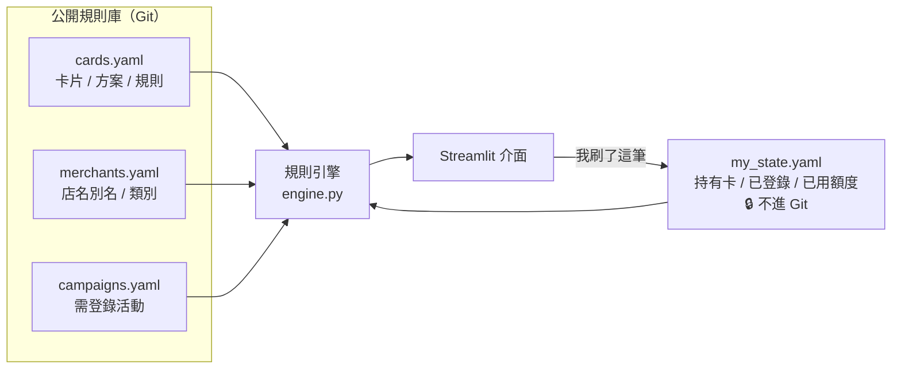

# 💳 刷卡建議助理 Card Assistant

> 輸入店名和金額，告訴你**該刷哪張卡、要切哪個權益方案、用哪個支付**，並把回饋上限、活動期限、指定支付方式都算進去。

**Demo**：（部署後填入 Streamlit 連結）　|　**技術**：Python · Streamlit · PyYAML · pytest


## 動機

手上有 8 張信用卡、3 個行動支付。台新 Richart、國泰 CUBE 要「切換權益方案」才有高回饋，玉山 Unicard 又是看月底方案算整個月，再加上每張卡有不同的回饋上限、指定通路、需登錄的活動，每半年還會改版一次。站在結帳櫃台前，根本算不出來該刷哪張。

這個工具把「刷之前的決策」自動化：

| 功能 | 說明 |
|---|---|
| 🔍 刷哪張卡 | 店名（支援別名，例如「小七」→ 7-ELEVEN）＋金額 → 所有「卡 × 方案 × 支付」組合依預估回饋排序 |
| 🔄 權益方案總覽 | 切換型卡片的每個方案涵蓋哪些店，可搜尋店名 |
| 📌 待登錄 / 到期提醒 | 需登錄、領券的活動清單；45 天內到期的權益，提醒去看新公告 |
| 📊 上限追蹤 | 按「我刷了這筆」累計本月已用的加碼額度，下次查詢自動扣掉，每月歸零 |
| 🎁 行動支付優惠 | 每週自動爬取 LINE Pay、全支付、悠遊付等活動，篩出跟「我的卡 / 支付」有關的，查店名時一併顯示 |

## 優惠爬蟲

行動支付的活動多半只在 App 內，官網又是 JavaScript 動態頁，所以改爬卡優新聞網「優支付」分類（購物、美食、生活、交通）。這些頁面是伺服器端渲染，每篇也附有官方來源連結。

```
列表頁（每分類最多 3 頁）→ 未過期且沒抓過的文章 → 擷取欄位 → data/promos.json
```

- **擷取**：從標題與內文用規則抓出支付方式、銀行（對應到我的卡）、最高 %、單筆門檻、上限、是否需登錄、是否限量，並比對已知店名。
- **降噪**：支付與銀行採「標題優先」，標題有提到就只看標題；內文列出超過 2 家銀行時視為「適用銀行一覽」，不當成限定卡。另外把「悠遊卡」（實體卡）和「悠遊付」（App）分開。
- **禮貌爬取**：自訂 User-Agent、請求間隔 1.5 秒、已抓過的不重抓、過期就停止翻頁。只存結構化欄位、160 字摘要與原文連結，不轉存全文。
- **自動更新**：GitHub Actions 每週一執行（`.github/workflows/promos.yml`），有變動才 commit，Streamlit Cloud 會自動重新部署。
- 爬到的活動只拿來**顯示**，不放進回饋排名：自動擷取的條件不夠可靠，不能直接當計算規則。

```bash
python -m card_assistant.promos --pages 3   # 手動更新
```

## 架構



```
card_assistant/engine.py   規則引擎（純函式，不依賴 Streamlit）
card_assistant/promos.py   行動支付優惠爬蟲 + 欄位擷取
app.py                     Streamlit 介面
data/                      規則庫 YAML + 個人狀態範例
tests/                     pytest，使用 fixtures 假規則
```

## 規則引擎設計

**規則是資料，不是程式碼。** 銀行改版時只要改 YAML，不用動任何 if-else。一條規則長這樣：

```yaml
- name: 百大指定
  rate: 0.03          # 總回饋率（含基本回饋）
  cap: 1000           # 加碼部分的上限
  cap_group: unicard  # 同 group 的規則共用額度
  pay: [card]         # 適用支付方式
  merchants: [新光三越, 蝦皮, ...]
  cats: [海外]        # 或用類別比對
```

計算流程：

1. **店名解析**：比對標準名、別名，再做子字串比對，得到「標準店名＋類別」（例如 東京 → 日本 → 海外）。
2. **展開候選**：對每張持有的卡 × 每個有效方案 × 每個可用支付方式，篩出符合條件的規則。條件包括期間、支付方式、店家或類別、最低金額、星期幾、假日、排除名單。
3. **計算回饋**：`基本回饋 + min(加碼, 剩餘上限)`。一般規則取最好的一條，`stack: true` 的活動加碼可以疊加。
4. **排序合併**：依回饋金額排序；同卡同方案、回饋相同的不同支付方式合併成一列。

刻意的設計決定：

- **上限只套在加碼部分。** 這符合多數銀行的條款寫法：超過上限仍有基本回饋。
- **月結型方案可以固定。** 玉山 Unicard 以月底方案計算整月，所以由使用者固定當月方案，而不是每筆都推薦最高的 UP 選。
- **不爬銀行 App。** 銀行沒有公開 API，爬 App 也違反使用條款。權益來自公開公告，用量由使用者按鈕記錄。
- **每條規則都附來源網址和到期日。** 規則資料一定會過期，所以讓「過期提醒」成為一級功能。

測試涵蓋：上限部分用完、完全用完、共用上限、活動過期、支付方式條件、假日加最低金額的多重條件、排除通路、未登錄活動提醒、跨月歸零。

```bash
python -m pytest -q
```

## 隱私處理

- 規則庫只有公開權益資訊；個人資料（持有卡、登錄狀態、用量）放在 `data/my_state.yaml`，已列入 `.gitignore`。
- 公開 demo 沒有這個檔案，會自動讀取 `my_state.example.yaml`，記錄只存在當次瀏覽的 session，不寫檔。
- 不處理任何卡號、帳單或銀行登入資訊。

## 本機執行

```bash
python -m pip install -r requirements.txt
cp data/my_state.example.yaml data/my_state.yaml   # 改成自己的卡
python -m streamlit run app.py
```

## 限制

- 權益資料整理自銀行公告與第三方整理文章（見 `cards.yaml` 各卡 `source`），標記 `verify: true` 的尚未對照官網，實際以銀行公告為準。
- 上限以日曆月估算，帳單週期不同的卡會有誤差。
- 費率假設已設定帳戶自動扣繳（台新 LEVEL 2、國泰 Level 2）。

## Roadmap

- [ ] 熱門高回饋卡比較：「多辦一張 X 卡，每月可多拿多少」
- [ ] 定期檢查官網權益頁變動
- [ ] LINE Bot 查詢（LINE Messaging API）
- [ ] PTT Lifeismoney 優惠比對（第二個優惠來源）
- [ ] 優惠一鍵轉成計算規則（人工確認後寫入 campaigns.yaml）
